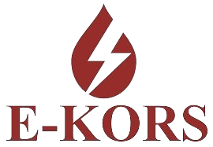

<p align="center">
  
</p>

<h1 align="center">Ekors ERP</h1>

<p align="center">
  Full-stack ERP module for quotation management, tickets and user administration with Node.js, MongoDB and REST APIs.
</p>

<p align="center">
  
  
  
</p>
<p align="center">
  <a href="https://dashboard.render.com/web/srv-d0vb6pq4d50c73ec7ip0"><strong>Live Project</strong></a>
</p>


## Overview

Full-stack ERP module for quotation management, tickets and user administration with Node.js, MongoDB and REST APIs.

This README is structured as a professional project handoff: it explains the purpose, stack, setup flow, and maintenance expectations so the repository is easier to evaluate, run, and extend.

## Highlights

- Clear implementation of the project goal: Full-stack ERP module for quotation management, tickets and user administration with Node.js, MongoDB and REST APIs.
- Organized repository structure for maintainable iteration and future extension.
- Built around JavaScript, Node.js, Vite with pragmatic tooling choices.
- Tagged for discoverability around mongodb, nodejs, erp, quotation-management, rest-api.

## Tech Stack

- JavaScript
- Node.js
- Vite

<p>
  
  
  
</p>

## Getting Started

### Prerequisites

- Git
- A runtime appropriate for the stack listed above

### Installation

```bash
git clone https://github.com/RaghavSobti37/Ekors-ERP.git
cd Ekors-ERP
npm install
```

### Development

```bash
npm run dev
```

### Production Build

```bash
npm run build
```

## Project Structure

The repository is organized around the source code, configuration, and project assets needed to run or extend the application. Start with the main entry point and configuration files, then follow the feature or module directories from there.

## Quality Notes

- Keep implementation changes small, reviewed, and easy to reason about.
- Document new environment variables, scripts, and external services as they are added.
- Prefer clear naming and predictable structure over clever abstractions.
- Validate user-facing flows after any dependency, routing, or deployment change.

## Topics

- mongodb
- nodejs
- erp
- quotation-management
- rest-api

## Author

Built and maintained by [Raghav Raj Sobti](https://github.com/RaghavSobti37).

Project link: [https://dashboard.render.com/web/srv-d0vb6pq4d50c73ec7ip0](https://dashboard.render.com/web/srv-d0vb6pq4d50c73ec7ip0)

